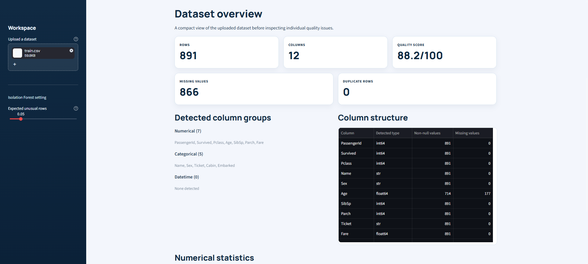
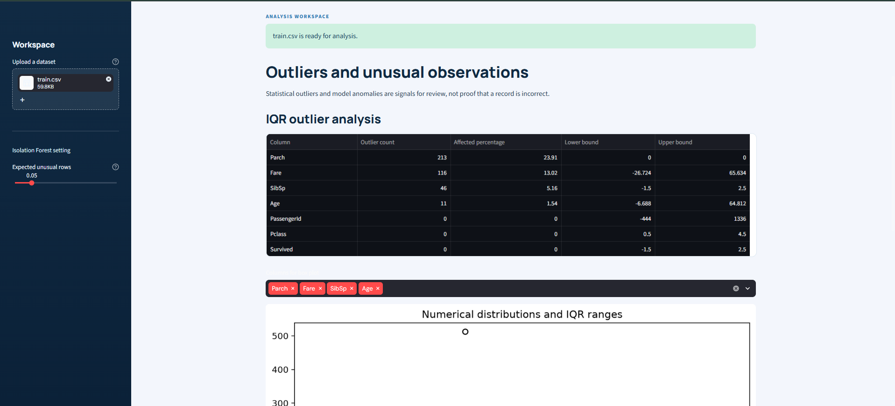

# 🛡️ DataGuard

**Automated data quality analyzer built with Streamlit.**

DataGuard checks how clean and reliable a dataset is before you analyse it. Upload a CSV or Excel file and get a full quality audit, an explainable 0-100 score, outlier and anomaly detection, optional AI insights, and a downloadable PDF report.

## Features

- Upload CSV, XLSX or XLS files with clear error messages
- Dataset profiling: shape, column types, memory usage, summary statistics
- Missing value and duplicate analysis
- Consistency checks: numbers stored as text, inconsistent categories, mixed date formats
- Outlier detection using the IQR method
- Anomaly detection using Isolation Forest
- Data Quality Score from 0 to 100 with a penalty breakdown
- Charts: missing values, histograms, box plots, correlation heatmap
- Optional AI Insights using the Groq API (only a compact summary is sent, not your raw data)
- Multi-page PDF report

## Data Quality Score

The score starts at 100 and subtracts capped penalties:

| Issue | Max penalty |
|---|---|
| Missing data | 30 |
| Duplicate records | 15 |
| Type and format issues | 20 |
| Statistical outliers | 20 |
| ML anomalies | 15 |

**Categories:** Excellent (85+), Good (70-84), Fair (50-69), Poor (below 50).
This is a project-specific indicator, not an industry standard.

## Tech Stack

Python, Streamlit, Pandas, NumPy, Scikit-learn, Matplotlib, OpenPyXL, ReportLab, Groq API

## Getting Started

```bash
git clone https://github.com/<your-username>/DataGuard.git
cd DataGuard

python -m venv .venv
source .venv/bin/activate      # Windows: .venv\Scripts\activate
pip install -r requirements.txt

streamlit run app.py
```

### Enable AI Insights (optional)

Create a `.env` file in the project root:

GROQ_API_KEY=your_key_here

The app works fully without a key. Only the AI Insights page needs it.

## Project Structure

```text
DataGuard/
├── app.py                  # Streamlit UI
├── requirements.txt
├── .streamlit/config.toml
└── utils/
    ├── analysis.py         # Profiling, missing, duplicates, outliers, anomalies
    ├── scoring.py          # Data Quality Score
    ├── ai_insights.py      # Groq-powered insights
    └── report_generator.py # PDF report
```

## App Pages

Overview, Data Quality, Outliers & Anomalies, Visualizations, AI Insights, Report

## Screenshots

### Overview


### Outliers & Anomalies


## Future Improvements

- Data-cleaning actions with a downloadable cleaned file
- Before/after quality score comparison
- Support for larger files and database connections

## Author

**Parth Verma**
[GitHub](https://github.com/parthverma2105) | [LinkedIn](www.linkedin.com/in/parth-verma-5821a4320)